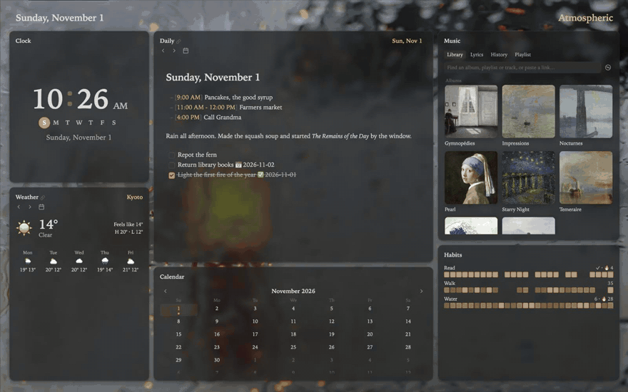

# Atrium™ for Obsidian

**A room for your day.** Open Obsidian and land somewhere nice: today's note, your agenda, the weather and a song, arranged however you like.

- **The day, front and centre.** Today's note in the middle, editable in place; the agenda, weather and month follow along.
- **Drag the walls.** Tiles or columns, stacks and floating cards, and a key for every move.
- **A workspace for every mood.** Each with its own cards, layout and moving background.
- **Cards for everything.** Agenda, tasks, calendar, weather, notes, music, podcasts, a terminal, the web.

### **[See it at atrium-md.com →](https://atrium-md.com)**

## Install

In Obsidian: **Settings → Community plugins → Browse**, search for **Atrium**, then **Install** and **Enable**. The [guide](https://atrium-md.com/tiles-and-columns) shows the rest.

## Atrium Complete

Atrium is free. **Atrium Complete** add a growing list of special modules and video backgrounds: try it free for 30 days, then $14.99 once. [More](https://atrium-md.com/atrium-complete).

## Network use

Atrium goes online only for what you ask of it: the weather ([Open-Meteo](https://open-meteo.com)), the web pages and podcast feeds you open, podcast search ([Podverse](https://podverse.fm)), your license key, once ([Polar](https://polar.sh)), and on a Mac, its two helpers from this repo's releases. [The full list](https://atrium-md.com/network-use).

---

Proprietary software; see the [license](LICENSE). Atrium™ is a trademark of Sebastien Delisle. Questions: support@atrium-md.com
