# Atrium™ for Obsidian

### **[Learn more at atrium-md.com →](https://atrium-md.com)**

## Modules

Each card on an Atrium page is a module. Add one from **Add module**: click a dotted line between cards, or press <kbd>⇧A</kbd> then an arrow. What a card shows comes from your notes, and what it changes goes back into them.

<table>
<tr>
<td width="33%" valign="top"><a href="https://atrium-md.com/daily">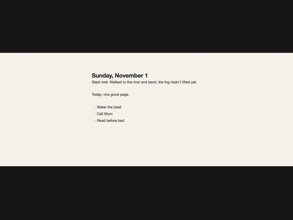</a> <b><a href="https://atrium-md.com/daily">Daily</a></b> Today’s note, editable in place.</td>
<td width="33%" valign="top"><a href="https://atrium-md.com/monthly">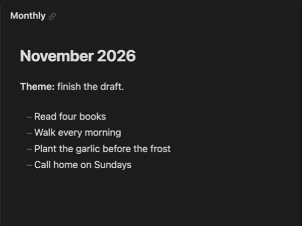</a> <b><a href="https://atrium-md.com/monthly">Monthly</a></b> The month’s note, following the day.</td>
<td width="33%" valign="top"><a href="https://atrium-md.com/note">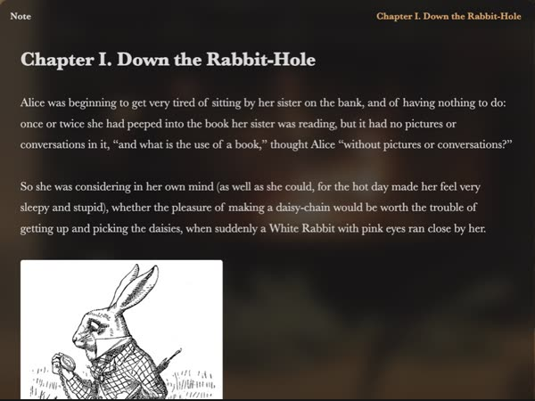</a> <b><a href="https://atrium-md.com/note">Note</a></b> Any note, pinned where you want it.</td>
</tr>
<tr>
<td width="33%" valign="top"><a href="https://atrium-md.com/agenda">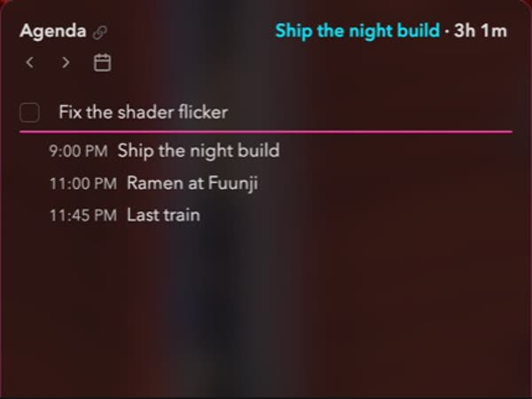</a> <b><a href="https://atrium-md.com/agenda">Agenda</a></b> Tasks and events: list, timeline, week, month.</td>
<td width="33%" valign="top"><a href="https://atrium-md.com/calendar">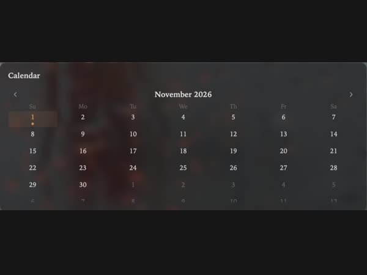</a> <b><a href="https://atrium-md.com/calendar">Calendar</a></b> The month, a dot where notes are.</td>
<td width="33%" valign="top"><a href="https://atrium-md.com/tasks">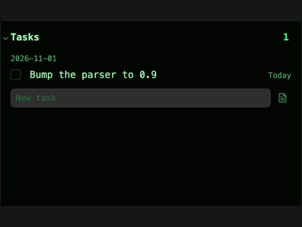</a> <b><a href="https://atrium-md.com/tasks">Tasks</a></b> What’s due, overdue first.</td>
</tr>
<tr>
<td width="33%" valign="top"><a href="https://atrium-md.com/upcoming">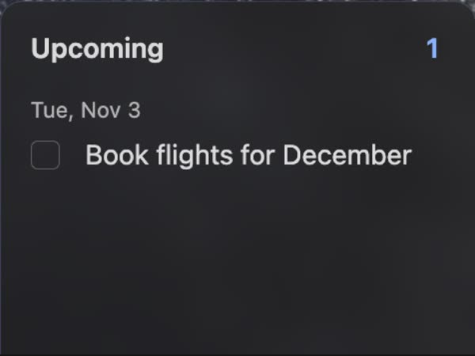</a> <b><a href="https://atrium-md.com/upcoming">Upcoming</a></b> What’s coming next.</td>
<td width="33%" valign="top"><a href="https://atrium-md.com/weather">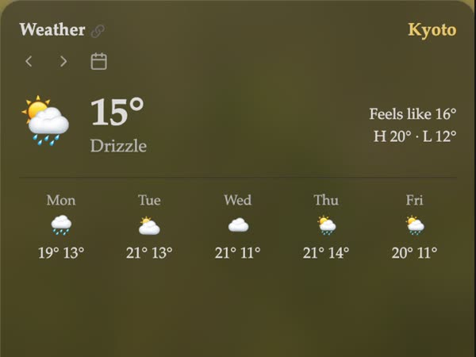</a> <b><a href="https://atrium-md.com/weather">Weather</a></b> Now, today and the days ahead.</td>
<td width="33%" valign="top"><a href="https://atrium-md.com/clock">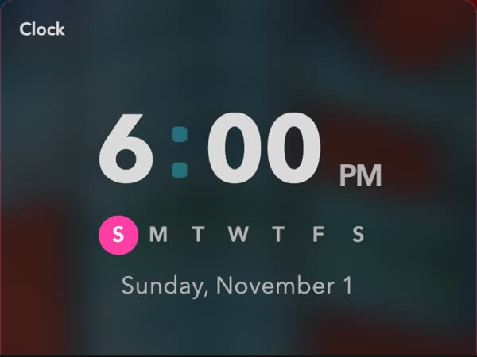</a> <b><a href="https://atrium-md.com/clock">Clock</a></b> The time, at any size.</td>
</tr>
<tr>
<td width="33%" valign="top"><a href="https://atrium-md.com/pomodoro">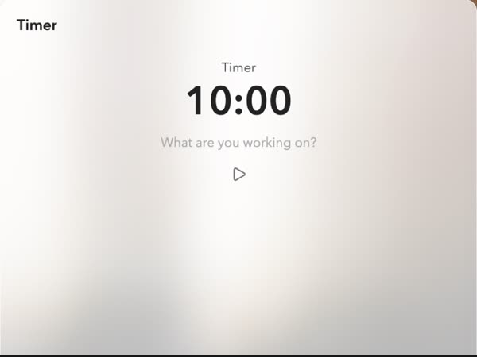</a> <b><a href="https://atrium-md.com/pomodoro">Pomodoro</a></b> Focus, breaks, countdowns.</td>
<td width="33%" valign="top"><a href="https://atrium-md.com/recent-files">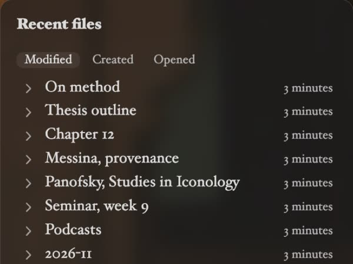</a> <b><a href="https://atrium-md.com/recent-files">Recent files</a></b> What you touched last.</td>
<td width="33%" valign="top"><a href="https://atrium-md.com/files">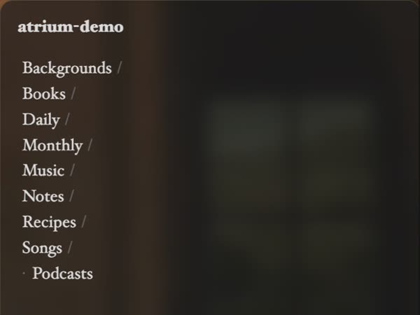</a> <b><a href="https://atrium-md.com/files">Files</a></b> A folder of your vault, run from the keys.</td>
</tr>
<tr>
<td width="33%" valign="top"><a href="https://atrium-md.com/music">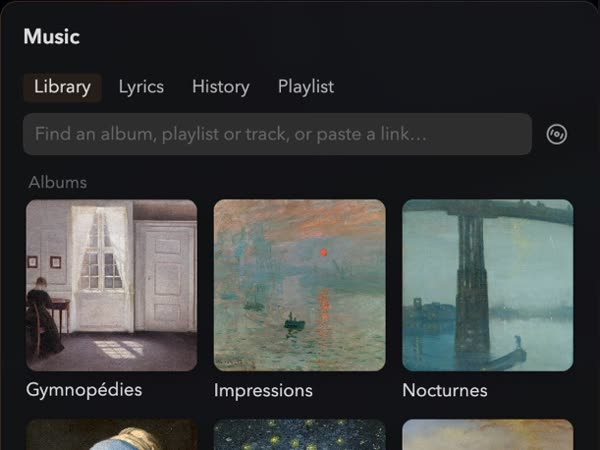</a> <b><a href="https://atrium-md.com/music">Music</a></b> ● Your own music files and YouTube links, with lyrics and playlists.</td>
<td width="33%" valign="top"><a href="https://atrium-md.com/podcasts">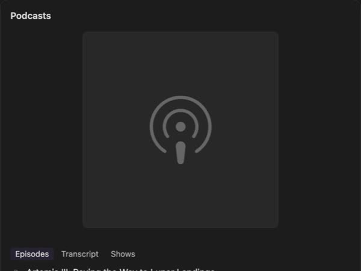</a> <b><a href="https://atrium-md.com/podcasts">Podcasts</a></b> ● Shows and episodes, where you left off.</td>
<td width="33%" valign="top"><a href="https://atrium-md.com/recorder">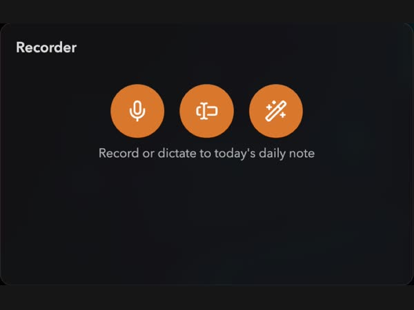</a> <b><a href="https://atrium-md.com/recorder">Recorder</a></b> ● Record, dictate, speak a command.</td>
</tr>
<tr>
<td width="33%" valign="top"><a href="https://atrium-md.com/terminal">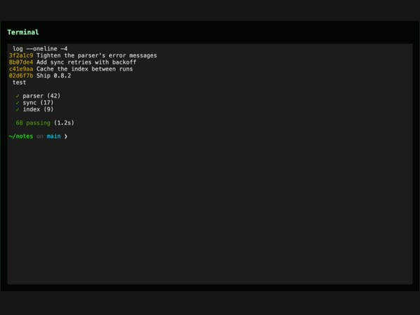</a> <b><a href="https://atrium-md.com/terminal">Terminal</a></b> ● A real shell, in a card.</td>
<td width="33%" valign="top"><a href="https://atrium-md.com/web-page">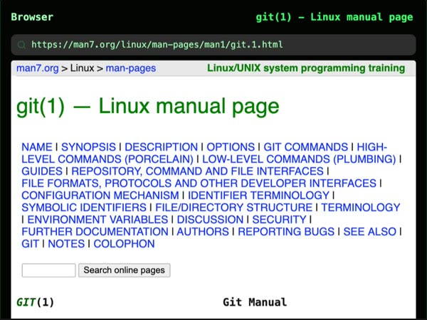</a> <b><a href="https://atrium-md.com/web-page">Web page</a></b> ● The web, or a web app, one card over.</td>
<td width="33%" valign="top"><a href="https://atrium-md.com/focus">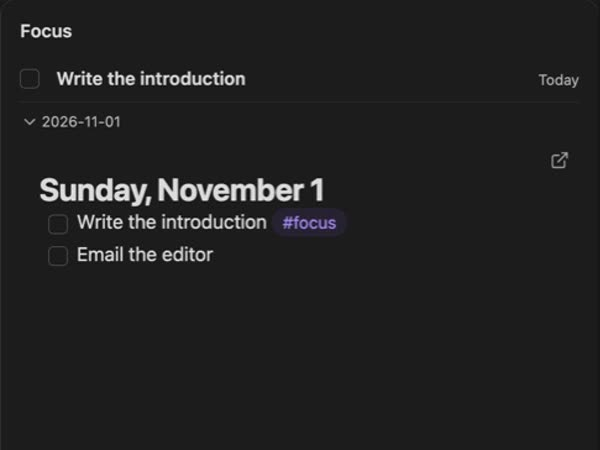</a> <b><a href="https://atrium-md.com/focus">Focus</a></b> ● The task you’re on, and nothing else.</td>
</tr>
<tr>
<td width="33%" valign="top"><a href="https://atrium-md.com/time-machine">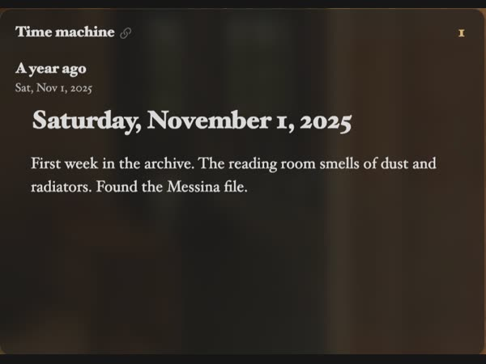</a> <b><a href="https://atrium-md.com/time-machine">Time machine</a></b> ● What you wrote a year ago today.</td>
<td width="33%" valign="top"><a href="https://atrium-md.com/habits">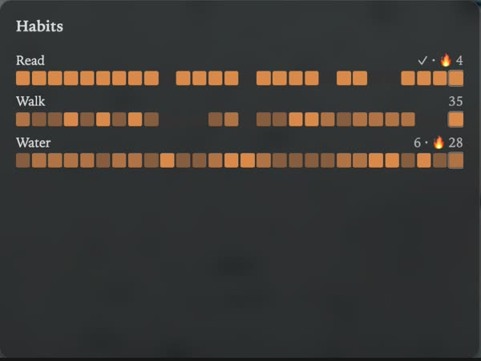</a> <b><a href="https://atrium-md.com/habits">Habits</a></b> ● Little streaks, kept in your notes.</td>
<td width="33%" valign="top"><a href="https://atrium-md.com/memorize">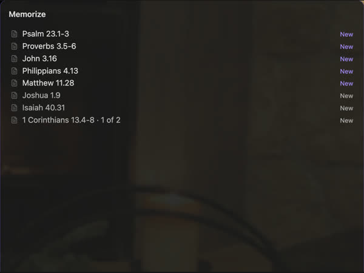</a> <b><a href="https://atrium-md.com/memorize">Memorize</a></b> ● Passages learned by heart, on a schedule.</td>
</tr>
</table>

Modules marked ● are part of [Atrium Complete](https://atrium-md.com/atrium-complete). Each name links to its page in the guide.

## Programs Atrium runs

On desktop, three cards start other programs on your computer through Node's `child_process`. To show only what works on your computer, Atrium first checks which of these programs are installed, with `/bin/sh`.

- **Terminal** runs your shell in the card, through Python 3 or `expect`.
- **Calendar events** (macOS) read and edit the Calendar app's events through `atrium-calendar`, a small helper, each time a card shows them. Without it, Atrium reads events from icalBuddy if you have it installed.
- **Dictation and spoken commands** (macOS) turn speech into text through `atrium-speech`, a small helper using Apple's speech recognition. A spoken command can ask Claude Code, in a terminal card, if you turn that on.

Both helpers are built from the Swift source in [`helper/`](helper) and attached to each GitHub release. On a Mac, Atrium downloads them from GitHub once per version into its plugin folder and marks them executable with `chmod`.
